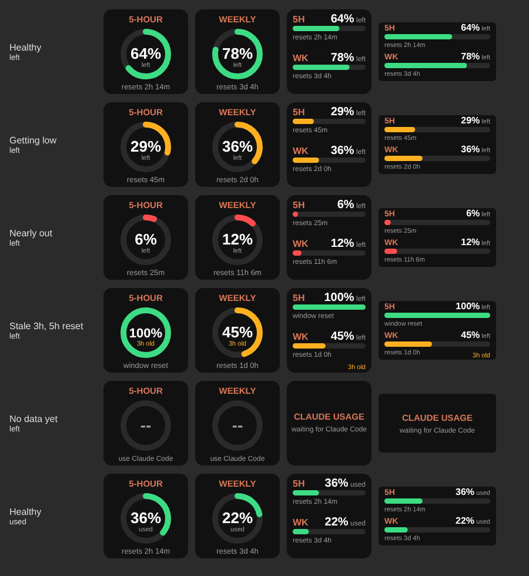

# ClaudeDeck: Claude usage on your Stream Deck

A Stream Deck plugin that shows how much of your Claude plan you have left: the rolling **5-hour** window and the **weekly** window.



| Action | Where | Shows |
| --- | --- | --- |
| 5-hour window | Key | Ring gauge, % left, time until reset |
| Weekly window | Key | Ring gauge, % left, time until reset |
| 5-hour + weekly | Key | Both windows as stacked bars |
| 5-hour + weekly (dial) | Stream Deck + dial / touch strip | Both windows as stacked bars |

Press a key (or push the dial / tap the strip) to flip between **% left** and **% used**. The same choice is in each action's settings panel.

Colours: green at 50%+ left, amber from 20%, red under 20%.

## How it gets the numbers (and what it doesn't do)

There is no public API for Claude plan limits. What *is* documented is that Claude Code passes `rate_limits.five_hour` and `rate_limits.seven_day` (percent used and reset time) to your [status line script](https://code.claude.com/docs/en/statusline) on Pro and Max plans.

So this plugin has three parts:

1. **The bridge** (`bridge/statusline-bridge.mjs`): Claude Code's status line runs it in the terminal. It saves those numbers to `~/.claude/streamdeck-usage.json` and prints a status line. If you already had a status line, the installer chains it, so your old one still shows.
2. **The mod** (`mod/`): a Claude Code plugin that writes the same file from any session, including the Claude desktop app and IDE extensions, which never run a status line.
3. **The plugin**: it reads that file every 5 seconds and draws the keys. It redraws every 30 seconds so the countdowns keep moving.

It never touches your OAuth token or makes any network request.

**The trade-off:** the numbers only update when you're using Claude Code. Usage you burn in the claude.ai app or desktop app shows up the next time you send a Claude Code message. When the numbers are over an hour old, the keys say so in amber (e.g. `3h old`). Once a window's reset time passes, the key shows it as 100% left, because it is.

## Setup (first time)

### 1. Install the tools

- **Stream Deck app 7.1 or newer** (Windows 10+ or macOS 12+).
- **Node.js 20 or newer**, only for building. The Stream Deck app runs the plugin on its own bundled Node 24. Check with `node -v`.
- **Claude Code** signed in with a Pro or Max plan.

### 2. Get the code and dependencies

```sh
git clone https://github.com/PixelChew/ClaudeDeck.git
cd ClaudeDeck
npm install
```

### 3. Hook up the bridge

```sh
npm run install-bridge
```

This copies the bridge to `~/.claude/streamdeck-usage-bridge.mjs` and sets `statusLine` in `~/.claude/settings.json`. It backs up your settings to `settings.json.bak-streamdeck` first.

Now open Claude Code and send any message. Your status line should read something like `Opus · 5h 77% left · wk 59% left`, and `~/.claude/streamdeck-usage.json` should exist.

To undo it: `npm run remove-bridge`.

If you use Claude Code in the **desktop app** (or an IDE), also install the mod, since those never run a status line:

```sh
npm run install-mod
```

It adds this repo as a plugin marketplace and installs `claudedeck-bridge@claudedeck`. It loads in sessions you start after installing. To undo it: `npm run remove-mod`.

### 4. Build and link the plugin

```sh
npm run build
npx streamdeck link com.pixelchew.claude-usage.sdPlugin
npx streamdeck restart com.pixelchew.claude-usage
```

`link` symlinks this folder into Stream Deck's plugins folder, so rebuilding updates the installed plugin. You don't need to copy anything.

Open the Stream Deck app. A **Claude Usage** category appears in the action list on the right. Drag the actions onto keys, or onto a dial on a Stream Deck +.

## Developing

```sh
npx streamdeck dev     # one-off: turns on developer mode in the Stream Deck app
npm run watch          # rebuilds on save and restarts the plugin
```

- **Logs:** `com.pixelchew.claude-usage.sdPlugin/logs/`
- **Debugger:** the manifest has `"Debug": "enabled"`, so in watch mode you can attach the VS Code / Chrome Node debugger to the plugin.
- **Code map:** `src/usage.ts` reads the snapshot and works out % left and resets. `src/render.ts` draws every key and the dial as SVG. `src/actions/` holds the four actions.

### Testing without burning usage

Write a fake snapshot. The plugin picks it up within 5 seconds. Bash or zsh:

```sh
now=$(date +%s)
echo "{\"updated_at\":$now,\"five_hour\":{\"used_percentage\":71,\"resets_at\":$((now+2700))},\"seven_day\":{\"used_percentage\":35,\"resets_at\":$((now+200000))}}" > ~/.claude/streamdeck-usage.json
```

PowerShell:

```powershell
$now = [DateTimeOffset]::UtcNow.ToUnixTimeSeconds()
@{ updated_at = $now; five_hour = @{ used_percentage = 71; resets_at = $now + 2700 }; seven_day = @{ used_percentage = 35; resets_at = $now + 200000 } } | ConvertTo-Json | Set-Content "$HOME\.claude\streamdeck-usage.json"
```

Try `used_percentage` at 95 for red. Set `updated_at` to `$now - 10800` to see the stale marker. Set a `resets_at` in the past to see a reset. Your next real Claude Code message overwrites the fake values.

To see the "waiting for Claude Code" screen, delete the file and restart the plugin.

## Sharing it

```sh
npm run validate
npm run pack
```

`pack` creates `com.pixelchew.claude-usage.streamDeckPlugin`. Double-click that file to install the plugin on any machine. That machine still needs the bridge (step 3).

## Troubleshooting

- **Keys stuck on "waiting for Claude Code":** check that `~/.claude/streamdeck-usage.json` exists. If it doesn't, check `statusLine` in `~/.claude/settings.json` and send a message in Claude Code. In the desktop app the status line never runs, so install the mod (`npm run install-mod`) and start a new session. `rate_limits` only appears on Pro/Max plans, and only after the first reply in a session.
- **Status line blank after installing:** run the command from `settings.json` by hand with `echo '{}' |` in front of it to see any error.
- **Moved Node or the repo?** Run `npm run install-bridge` again. It records the absolute path to `node`.
